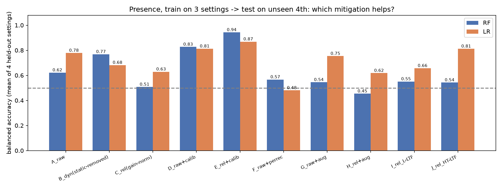
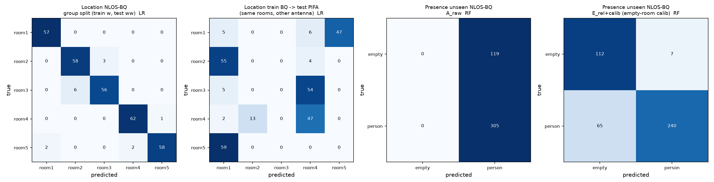
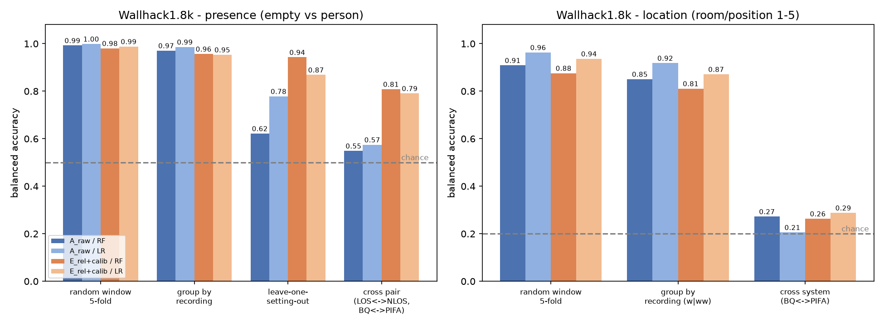
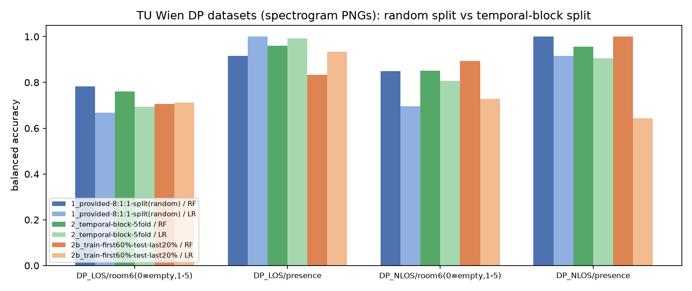
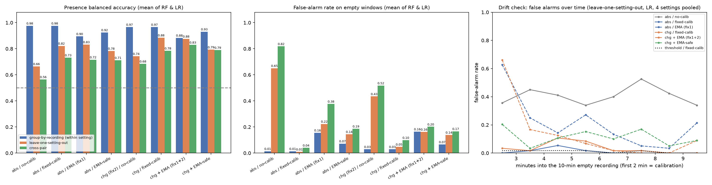
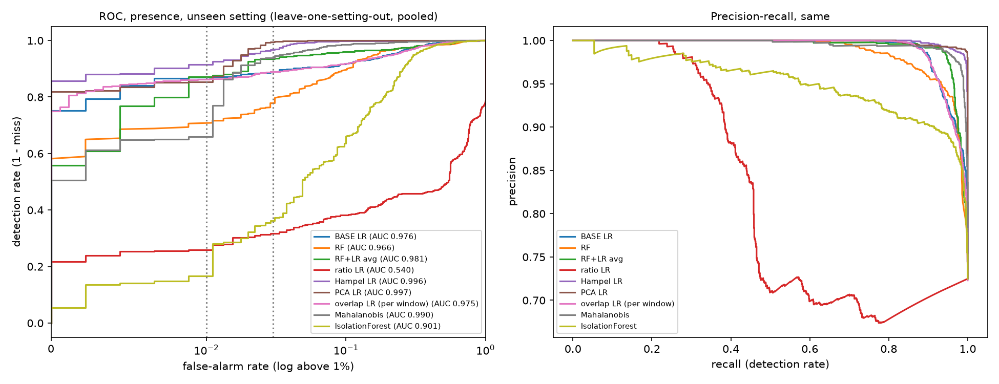
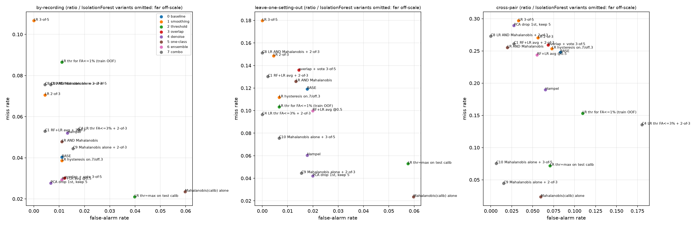

# WaveSense 보드 구매 전 사전 검증: 공개 ESP32 CSI 데이터로 파이프라인 재현

작성: 2026-11-11 (KST). 아래 숫자는 전부 이 폴더의 스크립트를 실제로 돌려서 나온 값이다(`results/*.csv`). 지표는 balanced accuracy(클래스 불균형 보정 정확도)를 기본으로 쓴다. 우연 수준은 2클래스면 0.50, 5클래스면 0.20이다.

## 1. 사용한 데이터
| 데이터 | 받은 파일 | 실제 내용 | 이번에 쓴 라벨 |
|---|---|---|---|
| **Wallhack1.8k** (Zenodo 13950918, Strohmayer & Kampel 2024) | `wallhack1.8k.zip`(135MB) 전체 | **원시 CSI**(ESP32, 100Hz, 패킷마다 I/Q 128슬롯). 4개 세팅: LOS(18m 복도) / NLOS(벽 4개로 나뉜 방 5개) × 안테나 2종(BQ, PIFA). 세팅마다 `b1.csv`(빈 방 약 10분 1회 녹화), `w1~w5.csv`(방/구간 k에서 걷기, 약 2분), `ww1~ww5.csv`(걷기+팔 흔들기). 총 44개 녹화 | 재실(빈 방 vs 사람), 위치(방/구간 1~5), 활동(없음/걷기/걷기+팔) |
| **TU Wien ICVS 2023** (Zenodo 8021099) | `DP_LOS.zip`, `DP_NLOS.zip` (DA_* 활동용도 받았지만 미사용) | **원시 CSI가 아닌** 400×52 진폭 스펙트로그램 PNG(8비트, 스케일링 방식 불명). 녹화 ID 없음. 인덱스 순으로 정렬하면 **클래스마다 하나의 연속 블록**이라, 클래스 하나가 사실상 녹화 하나다 | 6클래스(0=빈 방, 1~5=방/위치), 재실 2클래스 |

- 둘 다 비상업 연구용 라이선스(이번 용도엔 문제 없음). CAD.zip은 안테나 3D 모델이라 안 씀.
- Wallhack 패킷 중 길이가 비정상인 3개만 버림(로그에 기록).
- 주의: 같은 저자/같은 건물에서 찍었을 가능성이 높아서, 두 데이터가 서로 독립된 환경이라고 보면 안 됨.

## 2. 파이프라인(포스터와 동일하게 구현)
CSI → 진폭 sqrt(I²+Q²) → **빈 서브캐리어 제거**(데이터 기준, 평균 진폭≈0인 슬롯 20개 제거 → 108개 남음: L-LTF 52 + HT-LTF 56) → **4초 창(400패킷, 겹침 없음)** → 서브캐리어별 통계 특징(평균, 표준편차, 범위, 1차 차분 평균) + 집계 특징(평균 표준편차, 에너지=분산, 최대 표준편차, 엔트로피) → RandomForest(300트리), 로지스틱 회귀(표준화 후, C=0.1). 둘 다 class_weight=balanced.

비교한 전처리/완화책(`CONFIGS`):
- A_raw: 위 그대로(절대 진폭 평균 포함) = 포스터 방식
- B_dyn: 정적 성분 제거(평균 빼고 변동 특징만)
- C_rel: 창 평균으로 나눈 상대 진폭(게인/AGC 불변)
- D_raw+calib / E_rel+calib: **설치 시 빈 방 보정**. 세팅마다 빈 방 녹화의 앞 20%(약 2분)를 보정 데이터로 쓰고, 그 통계로 특징을 z-score. 이 보정 창은 모든 평가에서 제외함
- F_raw+perrec: 녹화별 z-score(테스트 녹화 전체가 필요하고 라벨 정보가 새는 방식이라, 비교용으로만 넣음)
- G/H: 학습 데이터 증강(무작위 전체 게인 0.7~1.4배, 서브캐리어별 완만한 게인 곡선, 가우시안 노이즈, 2배수)
- I/J: 서브캐리어 선택(L-LTF만 / HT-LTF만)

## 3. 평가 방식
1. **무작위 창 분할 5-fold**: 같은 녹화의 이웃 창이 학습/테스트에 같이 들어가서 점수가 부풀려짐. 비교용.
2. **녹화 단위 분할(GroupKFold)**: 사람 녹화는 파일 단위로 묶음. 빈 방은 세팅마다 녹화가 1개뿐이라 시간순 5블록으로 나눔(같은 세션이라 여전히 약간 낙관적). 위치는 방마다 녹화가 w/ww 2개라, "w로 학습하고 ww로 테스트"와 그 반대로 2-fold.
3. **교차 환경**: 세팅 하나를 빼고 나머지 3개로 학습(leave-one-setting-out). 쌍별로는 LOS↔NLOS(같은 안테나), BQ↔PIFA(같은 공간, 다른 안테나).
4. TU Wien은 녹화 ID가 없어서, 제공된 8:1:1 분할(무작위)과 **클래스 블록 안 시간순 분할**(5-fold, 그리고 앞 60%로 학습해 마지막 20%로 테스트)을 비교함.

클래스 분포(평가 창 수, Wallhack 세팅별): 재실은 빈 방 115~119 / 사람 297~316이라 다수 클래스 기준선이 0.72. 위치는 방마다 57~66이라 기준선 약 0.21. 활동은 119/151~162/148~158.

## 4. 결과
### 4-1. Wallhack 재실 감지(빈 방 vs 사람), balanced accuracy, 4개 세팅 평균
| 평가 방식 | A_raw RF | A_raw LR | E_rel+calib RF | E_rel+calib LR | 다수 클래스 acc |
|---|---|---|---|---|---|
| 무작위 창 5-fold | 0.993 | 0.999 | 0.980 | 0.988 | 0.723 |
| 녹화 단위 5-fold | 0.971 | 0.986 | 0.957 | 0.954 | 0.723 |
| 세팅 하나 빼고 학습(처음 보는 환경) | **0.622** | 0.779 | **0.943** | 0.869 | 0.723 |
| 쌍별 교차(8쌍 평균) | 0.549 | 0.575 | 0.808 | 0.791 | 0.723 |

세팅별(녹화 단위, A_raw LR / RF): LOS-BQ 1.000/1.000, LOS-PIFA 1.000/0.998, NLOS-BQ 0.954/0.906, NLOS-PIFA 0.991/0.979.
처음 보는 환경, A_raw RF 기준: NLOS-BQ와 NLOS-PIFA는 0.500(모든 창을 "사람"으로 예측). E_rel+calib RF로 하면 LOS-BQ 0.965, LOS-PIFA 0.988, NLOS-BQ 0.864, NLOS-PIFA 0.954.

완화책 비교(세팅 하나 빼고 학습, RF/LR 평균 balanced acc): A_raw 0.62/0.78, B_dyn 0.77/0.68, C_rel 0.51/0.63, D_raw+calib 0.83/0.81, **E_rel+calib 0.94/0.87**, F_perrec 0.57/0.48, G_raw+aug 0.54/0.75, H_rel+aug 0.45/0.62, I_L-LTF 0.55/0.66, J_HT-LTF 0.54/0.81. → [results/fig2_mitigations_leave_one_setting_out.png](results/fig2_mitigations_leave_one_setting_out.png)

학습 없는 임계값 방식(`run_threshold.py`, 상대 진폭 표준편차가 보정 창의 99퍼센타일을 넘으면 사람): LOS-PIFA 1.000, LOS-BQ 0.930, NLOS-BQ 0.793(오경보 20%), NLOS-PIFA 0.658(오경보 25%, 미탐 43%). 벽 너머에서는 빈 방 신호가 10분 사이에도 흔들려서, 앞 2분 기준선을 뒤쪽 빈 방 창 20~25%가 넘어섬.

### 4-2. Wallhack 위치(방/구간 1~5, 사람 있는 창만), balanced accuracy
| 평가 방식 | A_raw RF | A_raw LR | E_rel+calib RF | E_rel+calib LR | 우연 |
|---|---|---|---|---|---|
| 무작위 창 5-fold (4세팅 평균) | 0.909 | 0.963 | 0.876 | 0.937 | 0.20 |
| 녹화 단위(w↔ww) | 0.851 | 0.918 | 0.811 | 0.871 | 0.20 |
| 같은 방, 다른 안테나(BQ↔PIFA, 4쌍 평균) | **0.273** | **0.206** | 0.263 | 0.288 | 0.20 |

세팅별(녹화 단위, A_raw LR): LOS-BQ 0.843, LOS-PIFA 0.876, NLOS-BQ 0.955, NLOS-PIFA 1.000. 벽으로 나뉜 방(NLOS)이 복도 구간(LOS)보다 구분이 쉬움.
교차 시스템은 어떤 완화책도 0.06~0.39 범위로, 사실상 우연 수준. 혼동행렬을 보면 방 번호가 통째로 다른 방으로 매핑됨 → [results/fig3_confusion_matrices.png](results/fig3_confusion_matrices.png)

### 4-3. Wallhack 활동(없음/걷기/걷기+팔), balanced accuracy
무작위 창 0.75~0.80 → 녹화 단위 0.48~0.53(다수 클래스 기준선 0.48과 비슷) → 처음 보는 환경 0.33~0.63(E_rel+calib RF가 0.625로 제일 높음). 걷기와 걷기+팔은 녹화를 바꾸면 구분이 안 됨. 무작위 분할 점수는 녹화(세션)를 외운 결과였음.

### 4-4. TU Wien DP(스펙트로그램 PNG), balanced accuracy, A_raw 특징
| 과제 | 제공 분할(무작위) RF / LR | 시간 블록 5-fold RF / LR | 앞60%→뒤20% RF / LR |
|---|---|---|---|
| DP_LOS 재실 | 0.917 / 1.000 | 0.960 / 0.993 | 0.833 / 0.933 |
| DP_NLOS 재실 | 1.000 / 0.917 | 0.957 / 0.905 | 1.000 / 0.643 |
| DP_LOS 6클래스(빈 방+위치 5) | 0.783 / 0.668 | 0.761 / 0.694 | 0.707 / 0.713 |
| DP_NLOS 6클래스(빈 방+방 5) | 0.848 / 0.697 | 0.851 / 0.806 | 0.893 / 0.728 |
교차: 재실 LOS→NLOS 0.600 / 0.593, NLOS→LOS 0.827 / 0.574 (RF / LR). 이 데이터는 클래스 = 녹화라서, 위 숫자 모두 "같은 세션 안"에서 잰 값이다. 실제 일반화 성능의 상한으로만 봐야 함.

## 5. 팀에 주는 시사점
1. **같은 방, 같은 보드, 같은 날이면 재실 감지는 거의 다 됨**(녹화 단위로도 0.91~1.00). 다만 공개 데이터의 "사람 있음"은 전부 **걷는 사람**이다. 가만히 서 있거나 앉거나 누운 사람은 데이터에 없어서 검증이 안 됐다. 사각지대 용도에서는 이게 제일 큰 공백이다.
2. **환경이나 안테나가 바뀌면 그대로는 무너진다.** 재실은 처음 보는 세팅에서 RF 0.62(두 세팅은 0.50), 위치는 다른 안테나에서 우연 수준(약 0.2~0.3)까지 떨어진다. 위치 분류기는 우리 방에서 우리 보드로 새로 학습해야 하고, 공개 데이터 사전학습으로는 위치를 못 옮긴다.
3. **제일 잘 듣는 싼 처방은 "설치할 때 빈 방 2분 녹화해서 기준 잡기"(E_rel+calib)였다.** 처음 보는 세팅 재실 RF가 0.62에서 0.94로 올랐다. 반면 증강(G/H), 서브캐리어만 고르기(I/J), 상대 진폭만 쓰기(C)는 일관된 개선이 없었다. 녹화별 z-score(F)는 오히려 망가뜨린다(0.48~0.57).
4. **빈 방 기준선은 시간이 지나면 흔들린다**(벽 너머 임계값 방식에서 오경보 20~25%). 주기적 재보정이나 기준선 갱신이 필요하다.
5. **평가할 때 무작위 창 분할은 쓰지 말 것.** 활동 인식은 0.79에서 0.5 근처로, 위치는 0.96에서 0.92로, 교차 환경에선 0.2~0.3까지 떨어졌다. 포스터·보고서 숫자는 녹화 단위나 날짜 단위 분할로 다시 내야 한다.

**보드 오면 먼저 모을 것(우선순위 순)**
1. 빈 방 녹화: 날짜/시간대를 바꿔서 여러 번(각 5~10분). 드리프트 측정용이자 보정용.
2. 2×2 각 구역에서 **정지 자세**(서기/앉기/눕기) + 걷기를 구역마다 최소 2~3회씩 **서로 다른 녹화(가능하면 다른 날)**로.
3. 장애물 있는 구역 4(사각지대)를 따로 많이: 장애물 있음/없음 둘 다.
4. Rx 3대를 각각 따로 저장(Rx별 성능, Rx 하나 빠졌을 때 성능 확인용).
5. 평가는 처음부터 "녹화/날짜 단위로 빼고 테스트"로 고정.

## 6. 공개 데이터가 커버하지 못하는 것(우리 셋업 대비)
- **Tx 1 + Rx 3, 방 모서리 배치**: 두 데이터 모두 송수신 1쌍(링크 1개)이다. Rx 3대 융합, 모서리 배치, 높이 1m 조건은 전혀 없음.
- **3m×3m 방의 2×2 구역**: 공개 데이터의 "위치"는 18m 복도 구간이나 벽으로 나뉜 방 5개라서, 한 방 안 1.5m 간격 구역 구분보다 훨씬 쉬운 문제다. 우리 과제는 더 어려울 가능성이 큼.
- **장애물로 만든 사각지대**: 해당 조건 없음(NLOS는 25cm 벽돌 벽).
- **정지한 사람**: 없음. 사람 있는 데이터는 걷기/팔 흔들기뿐.
- **여러 명, 다른 사람**: 각 데이터가 1명.
- **보드 차이**: 공개 데이터는 특수 안테나(BQ/PIFA)를 단 ESP32다. 우리가 살 보드(기본 PCB 안테나 ESP32-S3/C5 등)와 다르고, 안테나만 바꿔도 위치 분류가 무너졌으므로 숫자를 그대로 옮기면 안 됨.
- **날짜 간 변화**: 녹화가 세팅별로 한 번씩이라, 하루 이상 지난 뒤의 드리프트는 측정 못 함.
- **웹캠 영상 동기화**: 없음.

## 7. 한계
- 빈 방은 세팅마다 녹화가 1개라서, 재실의 "녹화 단위" 점수도 빈 방 쪽은 같은 세션 안에서 시간 블록으로만 나눈 것이다. 실제보다 낙관적일 수 있다.
- 위치 녹화 단위 분할은 방마다 녹화 2개(w/ww)로만 가능했다. 두 녹화는 활동도 다르다.
- TU Wien PNG는 8비트로 양자화돼 있고 정규화 방식을 몰라서, 절대 진폭 특징의 의미가 불확실하다. 녹화 단위 분할도 불가능했다.
- 하이퍼파라미터는 튜닝하지 않았다(RF 300트리, LR C=0.1 고정). 시드 1개(0)라 분산 추정이 없다.
- 교차 쌍과 처음 보는 세팅 점수는 테스트 세팅 1개짜리 단일 fold 값이라 흔들림이 크다.

## 8. 파일
- `load_wallhack.py`: 원시 CSV → 진폭 캐시(`cache/*.npz`)
- `features.py`: 빈 서브캐리어 제거, 4초 창, 특징, 증강
- `run_wallhack.py`: Wallhack 전체 실험(로그 `results_wallhack.log`, 결과 `results/wallhack_results.csv`, 712행)
- `run_threshold.py`: 학습 없는 임계값 방식(`results/threshold_results.csv`)
- `run_tuwien.py`: TU Wien PNG 실험(`results/tuwien_results.csv`, `results_tuwien.log`)
- `make_charts.py`: 그림 4개와 혼동행렬(`results/confusion_cases.csv`, `results/wallhack_confusion.json`)
- 그림: [results/fig1_accuracy_by_eval_scheme.png](results/fig1_accuracy_by_eval_scheme.png), [results/fig2_mitigations_leave_one_setting_out.png](results/fig2_mitigations_leave_one_setting_out.png), [results/fig3_confusion_matrices.png](results/fig3_confusion_matrices.png), [results/fig4_tuwien_split_comparison.png](results/fig4_tuwien_split_comparison.png)

- 재현: `.venv/bin/python load_wallhack.py && .venv/bin/python run_wallhack.py && .venv/bin/python run_threshold.py && .venv/bin/python run_tuwien.py && .venv/bin/python make_charts.py` (전체 약 30분, 8코어)

---

## 9. 추가 실험: 기준선 드리프트 대책 (2026-11-11 KST, `run_drift.py`, `make_drift_chart.py`)
과제는 재실 감지(빈 방 vs 사람)이고, 데이터는 Wallhack1.8k 4개 세팅이다. 결과는 `results/drift_results.csv`, 로그는 `results_drift.log`, 그림은 [results/fig5_drift_fixes.png](results/fig5_drift_fixes.png). 숫자는 전부 실행 결과다.

### 9-1. 무엇을 비교했나
- **특징 2종**
  - abs: 기존 방식(절대 진폭 평균 + 변동)
  - chg(대책 2): 변화 기반. 서브캐리어별 창 내 표준편차·분산, 1차 차분 에너지, 직전 창 대비 평균 진폭 변화율 + 집계값. 절대 진폭 수준은 안 씀
- **기준선 4종**(모두 인과적: 과거 창만 사용)
  - no-calib: 정규화 없음
  - fixed-calib: 처음 2분 빈 방으로 z-score, 이후 고정
  - EMA(대책 1): 처음 2분으로 시작. 라벨 없는 게이트(움직임 점수가 기준 평균+3σ 미만)가 "빈 방"이라고 하면 EMA(α=0.05, 창 4초 기준 시상수 약 80초)로 기준 평균/분산 갱신, 사람 감지 중엔 동결
  - EMA-safe: 같은 EMA인데, 게이트를 처음 2분 기준으로 고정하고 직전 3창(12초) 연속으로 조용할 때만 갱신. 첫 결과를 보고 추가한 변형이라 사후 설계임을 밝혀둠
- **임계값 탐지기**(학습 없음): 움직임 점수 > 기준 평균+3σ. 기준은 고정 / EMA / EMA-safe. no-calib은 다른 세팅에서 찾은 전역 임계값
- **스트림 구성(인위적임)**: 세팅마다 빈 방 녹화가 1개뿐이라, [빈 방 앞 20% = 보정] + 10×(빈 방 다음 조각 → 사람 녹화 1개)로 시간순으로 이어붙였다. 사람 녹화는 다른 세션이라 이음매에서 신호가 끊기고, 실제 사람이 들어오고 나가는 전환 구간은 데이터에 없다. 각 녹화의 첫 창은 "직전 창"이 없어서 모든 방법에서 뺐다.
- **평가**: 녹화 단위 5-fold(세팅 내), 세팅 하나 빼고 학습(4개), 쌍별 교차(8쌍). 정규화는 라벨 없이 스트림 전체에 인과적으로 적용한 뒤 분할했다. 드리프트 확인은 빈 방 녹화 안에서 보정 이후 앞쪽(2~6분)과 뒤쪽(6~10분)의 오경보율을 비교했다.

### 9-2. 결과(balanced accuracy / 오경보율, RF · LR, 각 방식 평균)
| 방법 | 녹화 단위 RF | 녹화 단위 LR | 처음 보는 세팅 RF | 처음 보는 세팅 LR | 교차 쌍 RF | 교차 쌍 LR |
|---|---|---|---|---|---|---|
| abs / no-calib | 0.966 / 0.021 | 0.985 / 0.006 | 0.551 / 0.898 | 0.779 / 0.403 | 0.551 / 0.897 | 0.578 / 0.739 |
| abs / fixed-calib | 0.966 / 0.021 | 0.985 / 0.006 | 0.822 / 0.009 | 0.821 / 0.011 | 0.662 / 0.008 | 0.802 / 0.072 |
| abs / EMA (대책1) | 0.887 / 0.173 | 0.903 / 0.139 | 0.837 / 0.230 | 0.828 / 0.215 | 0.691 / 0.395 | 0.742 / 0.358 |
| abs / EMA-safe | 0.910 / 0.088 | 0.939 / 0.056 | 0.794 / 0.146 | 0.771 / 0.142 | 0.718 / 0.172 | 0.705 / 0.201 |
| chg (대책2) / no-calib | 0.962 / 0.043 | 0.970 / 0.015 | 0.693 / 0.589 | 0.791 / 0.280 | 0.684 / 0.573 | 0.685 / 0.462 |
| **chg / fixed-calib** | 0.962 / 0.043 | 0.970 / 0.015 | 0.864 / 0.060 | **0.905 / 0.035** | 0.755 / 0.089 | **0.813 / 0.109** |
| chg + EMA (대책1+2) | 0.878 / 0.179 | 0.889 / 0.149 | 0.874 / 0.184 | 0.877 / 0.141 | **0.840** / 0.178 | 0.819 / 0.225 |
| chg + EMA-safe | 0.920 / 0.080 | 0.941 / 0.052 | 0.794 / 0.166 | 0.792 / 0.112 | 0.791 / 0.178 | 0.788 / 0.156 |

임계값 탐지기(학습 없음, 4세팅 평균): 고정 기준 0.821 / 오경보 0.011 / 미탐 0.348, EMA 0.571 / 0.007 / 미탐 0.852, EMA-safe 0.792 / 0.011 / 미탐 0.405. no-calib 전역 임계값(세팅 하나 빼고): 0.498 / 오경보 0.498.
(세팅 내 녹화 단위에서 no-calib과 fixed-calib 값이 같은 건, 세팅 단위 z-score가 선형 변환이라 RF와 표준화 LR 결과를 바꾸지 않기 때문이다.)

**EMA가 사람을 기준선에 흡수한 비율**(사람 창 중 갱신에 쓰인 비율): 일반 EMA 0.851, EMA-safe 0.228. 빈 방 창 중 갱신에 쓰인 비율은 각각 0.994, 0.870.

**드리프트 확인: 빈 방 녹화 안 오경보율, 앞쪽(2~6분) → 뒤쪽(6~10분)**, 세팅 하나 빼고 학습 기준(RF / LR)
- abs / no-calib: 0.962→0.835 / 0.386→0.420
- abs / fixed-calib: 0.017→0.000 / 0.022→0.000
- abs / EMA: 0.371→0.089 / 0.324→0.106
- chg / fixed-calib: 0.056→0.064 / 0.060→0.009
- chg + EMA: 0.325→0.043 / 0.256→0.025
- chg + EMA-safe: 0.200→0.131 / 0.123→0.102
- 임계값 고정 기준: 0.018→0.004

1분 단위 곡선(LR)을 보면 EMA 방식은 보정 직후 2~3분 구간 오경보가 0.63~0.66으로 가장 높다. → 그림 3번째 패널

### 9-3. 해석
1. **변화 기반 특징(대책 2) + 처음 2분 고정 보정이 가장 균형이 좋았다.** 처음 보는 세팅에서 LR 0.905 / 오경보 3.5%, 교차 쌍에서 0.813 / 10.9%였다. 보정 없이 변화 특징만 쓰면(0.69~0.79, 오경보 28~59%) 부족하다. 즉, 변화 특징만으로는 환경 차이가 안 없어지고, 빈 방 보정이 같이 있어야 한다.
2. **자동 갱신 기준선(대책 1)은 이 데이터에서 오히려 손해였다.** 게이트를 통과한 사람 창이 기준선에 섞인다(일반 EMA는 사람 창 85% 흡수). 그러면 기준이 사람 쪽으로 끌려가 미탐이 늘고(임계값 탐지기 미탐 35%→85%), 학습 세팅과 테스트 시점의 정규화 분포가 어긋나 보정 직후 오경보가 튄다. 1+2 조합은 교차 쌍 RF에서 0.840으로 가장 높았지만 오경보가 18%라 실사용엔 부적합하다. 게이트를 고정하고 홀드오프를 둔 EMA-safe로 흡수율을 23%까지 줄여도 고정 보정보다 나아지지 않았다.
3. **10분 안의 드리프트는 고정 보정으로도 크게 문제 되지 않았다**(오경보 앞쪽 0~6% → 뒤쪽 0~6%). 앞 절(4-1)의 p99 임계값에서 오경보가 20~25% 나왔던 건 임계값 여유가 좁았기 때문이고, 평균+3σ로 잡으면 오경보는 1% 수준인 대신 미탐이 35%다. 즉 드리프트 문제는 "임계값 여유 vs 미탐" 트레이드오프로 나타난다.
4. **날짜·시간대 단위 드리프트는 이 데이터로 확인할 수 없다**(빈 방 녹화가 세팅당 10분 1개). 자동 갱신이 정말 필요한지는 실측(여러 날 빈 방 녹화)으로 판단해야 한다. 자동 갱신을 넣는다면 "보수적 게이트 + 긴 홀드오프 + 갱신 속도 상한"이 최소 조건이고, 몇 시간~하루 단위의 아주 느린 갱신만 하는 쪽이 안전하다.

### 9-4. 꼭 붙여야 할 단서
- **"사람 있음" 샘플은 전부 걷기(또는 걷기+팔 흔들기)다.** 변화 기반 특징은 움직임을 재는 특징이라 이 데이터에서는 인위적으로 좋아 보인다. 가만히 서 있거나 앉거나 누운 사람은 변화량이 빈 방과 비슷해서, 변화 특징만 쓰면 놓칠 가능성이 높다. 자동 갱신 기준선은 정지한 사람을 "빈 방"으로 학습해 버릴 위험이 더 크다. 이 데이터로는 둘 다 검증 불가.
- 스트림은 서로 다른 세션을 이어붙인 것이라, 사람이 들어오고 나가는 실제 전환과 EMA 반응 속도는 측정하지 못했다.
- α=0.05와 k=3은 사전에 정한 값이다. α 0.01~0.2, k 2~4 민감도는 `results/drift_threshold_sensitivity.csv`(임계값 탐지기 기준)에 있다. 그 범위 안에서 일반 EMA가 고정 기준보다 균형 정확도가 높은 조합은 없었다(가장 근접: k=2, α=0.01에서 0.846 vs 0.850). EMA-safe는 k=2, α 0.01~0.05에서 0.853~0.857로 고정 기준 0.850보다 근소하게 높았지만, 오경보는 0.059~0.070으로 고정 기준 0.052보다 오히려 높았다. 차이가 작아서 의미 있는 개선으로 보기 어렵다.
- 처음 보는 세팅과 교차 쌍은 테스트 세팅 1개짜리 단일 fold라 편차가 크다.

---

## 10. 추가 실험: 오탐 줄이기 (2026-11-11 KST, `run_fa.py` → `analyze_fa.py`)
- **기준(BASE)**: 변화 기반 특징 + 처음 2분 고정 보정 + LR(임계값 0.5)
- **결과 파일**: `results/fa_results.csv`(방법×평가방식, 95% 구간 포함), `results/fa_paired_vs_base.csv`(BASE 대비 차이의 95% 구간), `results/fa_per_setting.csv`, 로그 `results_fa.log`, `results_fa_analysis.log`
- **그림**: [results/fig6_fa_roc_pr.png](results/fig6_fa_roc_pr.png)(ROC/PR), [results/fig7_fa_vs_miss.png](results/fig7_fa_vs_miss.png)(오경보-미탐 산점도)

### 10-1. 방법과 공정성 규칙
- **지표 집계 방식이 9절과 다르다.** 이번엔 모든 테스트 창을 합쳐서(pooled) 계산했다. 9절은 세팅별 값을 평균했다. 또 시간 블록 경계에 걸친 창을 뺐다. 그래서 같은 BASE라도 처음 보는 세팅이 0.932 / 오경보 0.018 / 미탐 0.119로, 9절의 0.905 / 0.035와 다르다. 방법끼리 비교는 이 절 안에서만 할 것.
- **불확실성**: 95% 구간은 블록 부트스트랩(녹화 단위, 빈 방은 시간 블록 단위로 재표본, 500회)이다. "BASE 대비 차이" 구간이 0을 포함하면 노이즈 범위 안이라고 봤다.
- **튜닝 규칙**: 임계값 튜닝은 학습 fold 안의 out-of-fold 예측만 썼다(처음 보는 세팅 = 학습 세팅끼리 내부 교차, 교차 쌍 = 학습 세팅 안에서 녹화 단위 내부 교차). 또는 테스트 세팅의 설치 시 2분 빈 방 보정 데이터만 썼다(설치 시점에 실제로 얻을 수 있는 정보). 시드 0 고정. k-of-n, 히스테리시스, Hampel 등의 파라미터는 실행 전에 정했다.
- **사후 선택 표시**: 조합 C1~C10은 개별 결과를 본 뒤 골랐다(선택 편향 있음).
- **지연(latency)**: 사람 녹화의 첫 평가 창부터 첫 "사람" 판정까지 걸린 초. 녹화 시작을 "사람 등장"으로 간주한 인위적 측정이다. 사람이 나간 뒤 해제 지연은 데이터에 전환이 없어서 측정 못 했다.
- **k-of-n의 미탐에 구조적으로 포함되는 부분**: 각 녹화 시작의 (k−1)개 창이 미탐으로 잡힌다(약 30창짜리 녹화에서 2-of-3이면 약 3%p).
- **다중 Rx 합의(Rx 3대 중 2대 이상 동의 등)는 테스트 불가**: 데이터가 링크 1개뿐이다.

### 10-2. 결과 (balanced acc / 오경보 FA / 미탐, 중앙 지연)
| 방법 | 녹화 단위 | 처음 보는 세팅 | 교차 쌍 | 추가 지연 |
|---|---|---|---|---|
| **BASE** LR @0.5 | .974 / .011 / .040 | .932 / .018 / .119 | .834 / .083 / .248 | 0s |
| 1. LR 2-of-3 | .963 / .004 / .071 | .923 / .004 / .149 | .837 / .056 / .270 | 4s |
| 1. LR 3-of-5 | .947 / .000 / .107 | .910 / .000 / .180 | .835 / .033 / .297 | 8s |
| 1. 히스테리시스 on.7/off.3 | .975 / .011 / .039 | .941 / .007 / .112 | .837 / .073 / .254 | 0s |
| 1. 히스테리시스 on.9/off.5 | .969 / .004 / .058 | .924 / .004 / .148 | .847 / .021 / .285 | 0s (p90 29s, 교차) |
| 2. 임계값 FA≤3% (학습 OOF) | .966 / .042 / .027 | .957 / .015 / .071 | .842 / **.196** / .120 | 0s |
| 2. 임계값 FA≤1% (학습 OOF) | .951 / .011 / .086 | .945 / .007 / .103 | .869 / **.110** / .153 | 0s |
| 2. 임계값 = 테스트 보정 창 최대 | .970 / .040 / .021 | .945 / .058 / .053 | .929 / .071 / .072 | 0s |
| 3. 겹침 창 4s/1s, 창별 | .985 / .013 / .018 | .928 / .022 / .122 | .838 / .077 / .248 | 0s |
| 3. 겹침 + 3-of-5 투표 | .979 / .012 / .030 | .925 / .014 / .136 | .836 / .069 / .259 | 2s |
| 4. Hampel | .967 / .013 / .052 | .961 / .018 / .060 | .872 / .065 / .190 | 0s |
| 4. Hampel + Butterworth 10Hz | .974 / .011 / .040 | .935 / .018 / .112 | .887 / .045 / .181 | 0s |
| 4. 이동평균 0.1s | .975 / .009 / .040 | .935 / .018 / .112 | .839 / .027 / .295 | 0s |
| 4. 인접 서브캐리어 비율 | .867 / .128 / .139 | .621 / .181 / .577 | .602 / .364 / .433 | – |
| 4. PCA(1성분 제거, 5개 유지) | .983 / .007 / .028 | .969 / .020 / .042 | .842 / .028 / .289 | 0s |
| 5. Mahalanobis(보정 창) 단독 | .958 / .060 / .024 | .958 / .060 / .024 | .958 / .060 / .024 | 0s |
| 5. IsolationForest 단독 | .718 / .029 / .536 | .718 / .029 / .536 | .718 / .029 / .536 | – |
| 5. LR AND Mahalanobis | .971 / .011 / .048 | .930 / .013 / .126 | .862 / .020 / .255 | 0s |
| 6. RF+LR 평균 | .980 / .011 / .029 | .940 / .020 / .100 | .850 / .055 / .244 | 0s |
| C1 RF+LR 평균 + 2-of-3 | .971 / .004 / .053 | .934 / .002 / .130 | .856 / .028 / .261 | 4s |
| C4 LR 임계값 FA≤3% + 2-of-3 | .964 / .018 / .054 | .952 / .000 / .097 | .842 / .180 / .136 | 4s |
| C6 겹침 + RF+LR + 임계값 FA≤3% + 3-of-5 | .973 / .021 / .033 | .965 / .010 / .061 | .824 / .272 / .079 | 2s |
| C8 LR AND Mahalanobis + 2-of-3 | .960 / .004 / .076 | .924 / .000 / .151 | .864 / .000 / .273 | 4s |
| **C9 Mahalanobis 단독 + 2-of-3 (학습 없음)** | .970 / .015 / .045 | .970 / .015 / .045 | **.970 / .015 / .045** | 4s |
| C10 Mahalanobis 단독 + 3-of-5 (학습 없음) | .959 / .007 / .076 | .959 / .007 / .076 | .959 / .007 / .076 | 8s |

Mahalanobis 방식은 다른 데이터로 학습하지 않는다. 테스트 세팅 자신의 2분 보정 창(24개)만으로 Ledoit-Wolf 공분산을 맞추고, 임계값은 보정 창의 leave-one-out 거리 최대값으로 자동 결정한다. 그래서 세 평가 방식에서 값이 같다. ROC AUC(처음 보는 세팅, 합산): BASE LR 0.976, RF 0.966, RF+LR 0.981, Hampel 0.996, PCA 0.997, Mahalanobis 0.990, 겹침 0.975, IsolationForest 0.901, 비율 0.540.

**BASE 대비 차이가 노이즈를 넘은 것**(95% 구간이 0을 안 포함)
- k-of-n: 오경보는 확실히 줄고 미탐은 확실히 는다. 2-of-3은 처음 보는 세팅에서 FA −0.013 [−0.026, −0.002], 미탐 +0.029 [+0.021, +0.038].
- LR AND Mahalanobis: 교차 쌍에서 FA −0.063 [−0.101, −0.032], 미탐 +0.007.
- C8: 교차 쌍에서 FA −0.083 [−0.125, −0.046].
- C9: 교차 쌍에서 balanced acc +0.136 [+0.092, +0.180], FA −0.067 [−0.111, −0.026], 미탐 −0.204 [−0.281, −0.133]. 처음 보는 세팅에서는 balanced acc +0.038 [+0.001, +0.079]로 경계선.
- 비율 특징과 IsolationForest는 확실히 나빠짐.

**노이즈 범위 안**(구간이 0 포함): RF+LR 평균, 히스테리시스 0.7/0.3, Hampel(처음 보는 세팅 미탐 −0.059 [−0.117, −0.005]만 유의), Butterworth, 이동평균, PCA(교차 쌍 FA만 유의하게 감소, 미탐은 불확실), 겹침 창.

세팅별(처음 보는 세팅): BASE는 NLOS-BQ에서 미탐 0.478로 크게 실패했다. C9는 같은 세팅에서 FA 0.044 / 미탐 0.068이었고, 나머지 세팅은 FA 0~0.018, 미탐 0.033~0.045. C9의 빈 방 오경보 앞쪽→뒤쪽(10분 녹화 안): LOS-BQ 0.018→0.018, NLOS-BQ 0.035→0.053, 나머지 0→0.

### 10-3. 해석
1. **시간 평활(k-of-n)은 오경보를 확실히 줄이지만 공짜가 아니다.** 2-of-3은 지연 +4초에 미탐이 약 3%p 는다. 3-of-5는 처음 보는 세팅 FA 0, 지연 +8초, 미탐 +6%p. 히스테리시스(0.7/0.3)는 지연 없이 처음 보는 세팅 FA를 0.018→0.007로 줄였지만 노이즈 범위 안이다.
2. **학습 데이터에서 "오경보 1%/3%"로 맞춘 임계값은 다른 환경으로 안 옮겨진다.** 세팅 3개로 학습하면 목표를 대략 지켰다(FA 0.007, 0.015). 세팅 1개로 학습해 다른 세팅에 적용하면 FA 0.110, 0.196으로 목표의 10배 이상이다. 임계값은 현장에서 정해야 한다.
3. **겹침 창 + 투표, RF+LR 앙상블, 이동평균/Butterworth는 의미 있는 개선이 없었다.** Hampel과 PCA는 ROC AUC를 올렸지만(0.976 → 0.996/0.997) 임계값 0.5에서는 노이즈 범위 안이다. 인접 서브캐리어 비율은 이 특징 설계에선 성능을 망가뜨렸다.
4. **가장 좋았던 건 "설치 시 2분 빈 방에 대한 이상 탐지"(Mahalanobis) + 2-of-3이었다.** 학습 없이 모든 평가 방식에서 FA 1.5% / 미탐 4.5% / 지연 4초였다. 다른 환경 데이터로 학습한 분류기는 환경이 바뀌면 흔들렸는데(교차 쌍 미탐 25%), 현장 기준선과의 거리는 환경에 덜 민감했다. 오경보를 더 줄이려면 3-of-5(FA 0.7% / 미탐 7.6% / 지연 8초)를 쓰면 된다.

### 10-4. 추천 파이프라인 (현재 근거 기준)
변화 특징(4초 창) → 설치 시 빈 방 2분으로 z-score + Ledoit-Wolf Mahalanobis 모델 → 임계값 = 보정 창 leave-one-out 최대 거리(자동) → 2-of-3 연속 판정.
- 예상(공개 데이터 기준): 오경보 1.5% [0.6~2.7% 교차 쌍 구간], 미탐 4.5% [3.5~5.7%], 감지 지연 중앙값 4초(p90 4초).
- 조용한 시간대에 오경보를 더 줄이려면 3-of-5: 0.7% / 7.6% / 8초.
- 분류기(LR)는 "사람 vs 기타 변화"를 구분하는 보조로 AND 결합(C8: 교차 쌍 FA 0 / 미탐 27%)하는 선택지가 있다. 다만 미탐 비용이 커서 기본값으로는 권하지 않는다.

### 10-5. 꼭 붙일 단서
- **"사람 있음"은 전부 걷기다.** 이상 탐지와 변화 특징은 "뭔가 움직이면 감지"라서 이 데이터에서는 인위적으로 좋아 보인다. 가만히 있는 사람은 미탐이 훨씬 클 수 있다.
- **반대로 사람이 아닌 변화**(문 열림, 선풍기, 커튼, 반려동물, 가구 이동, 옆방 사람)도 Mahalanobis 방식에서는 그대로 "이상 = 사람"으로 잡힌다. 공개 데이터엔 이런 교란이 없어서, 실제 오경보는 여기서 잰 1.5%보다 클 가능성이 높다. 실측에서 꼭 교란 시나리오를 따로 녹화해야 한다.
- 보정 창이 24개(2분)뿐이라 Mahalanobis 공분산 추정이 불안정할 수 있다. 실측에서는 5~10분 보정을 권장한다. 날짜가 바뀌었을 때의 드리프트(9절)도 아직 미검증이다.
- 다중 Rx 합의는 이 데이터로 못 봤다. Rx 3대(또는 모서리 4대)가 생기면 "Rx 2대 이상 동의" 규칙이 k-of-n보다 지연 없이 오경보를 줄일 후보다.
